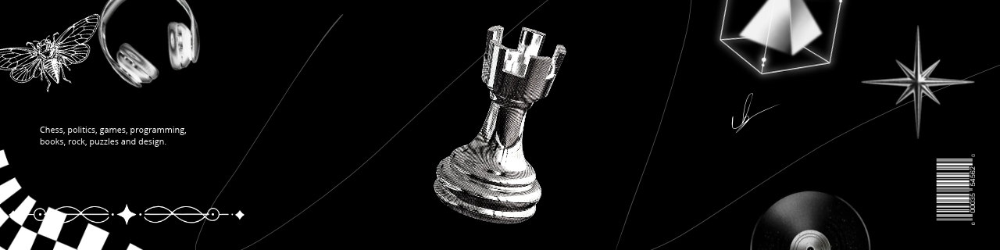
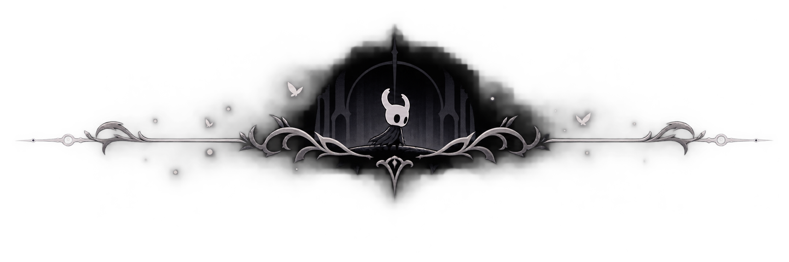
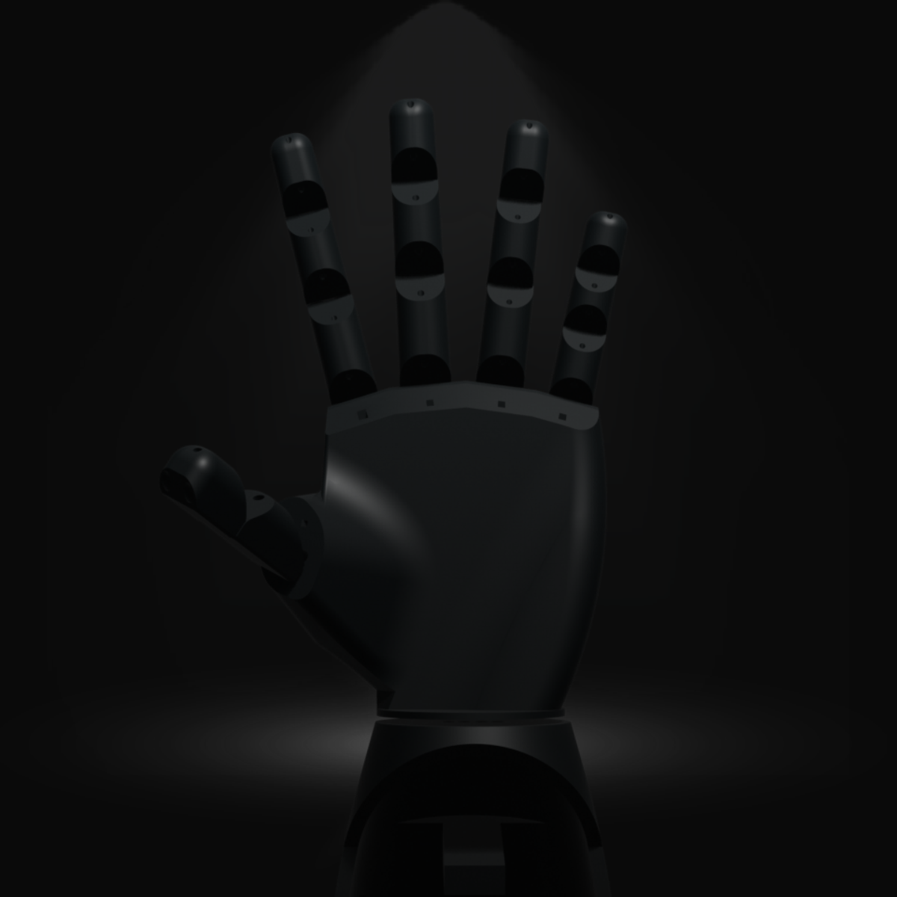

<!-- BANNER -->

  

 

<!-- INTRODUCTION -->

# Hi! I'm Claudio. 

**Systems Development Student | Software Developer**

*Building ideas into meaningful solutions.*

  

<!-- ABOUT ME -->

# About Me

I'm a student of Systems Development, interested in software engineering, design and pratical solutions.

Recently, I have been seeking to deepen my knowledge in:

- Development of applications and systems.
- POO.
- Database and software architecture.
- Embedded systems and Internet of Things (IoT).

I believe in the importance of writing organized code, developing consistent projects, and continuously learning.

 

<!-- PROJECTS -->

# Featured Projects

*Some projects I'm building and exploring.*

### Robotic Hand

A robotic hand controlled through an ESP32, featuring programmable finger movements and an interface for interaction.

**Technologies:** C++ · ESP32 · Kotlin · 3D Modeling

<!-- GITHUB STATISTICS -->

# GitHub Statistics

  

  

<!-- DIVIDER -->

  

<!-- TECH STACK -->

# Tech Stack

### Programming Languages

### Databases & Tools

### Design & Development

<!-- CONNECT -->

### Let's Connect

  

*Thanks for visiting my profile!*

